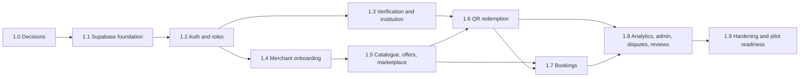

# Perqly implementation roadmap

**Phase 1: build order, dependencies, required changes and acceptance criteria**

|                     |                                                                                                                                                                                                              |
| ------------------- | ------------------------------------------------------------------------------------------------------------------------------------------------------------------------------------------------------------ |
| Status              | Approved 2026-11-14. Steps 1.1 and 1.2 in progress, locally only (no push, deploy or staging changes without approval)                                                                                       |
| Date                | 2026-11-14                                                                                                                                                                                                   |
| Companion documents | [Product specification](./PERQLY_PRODUCT_SPECIFICATION.md) · [Database](./PERQLY_DATABASE_ARCHITECTURE.md) · [User flows](./PERQLY_USER_FLOWS.md) · [QR redemption](./PERQLY_QR_REDEMPTION_SPECIFICATION.md) |

## 1. Where we are

Phase 0, step 1 is done and live at https://perqly-eta.vercel.app/: the Next.js foundation, design system, landing page, PWA baseline and placeholder area shells. There is no database schema, no Supabase project, no authentication and no real feature behind `/student`, `/merchant`, `/institution` or `/admin`.

This roadmap **replaces** two earlier lists: steps 2–6 of the README's "Upcoming steps", and Phase 1 of the earlier plan's roadmap. Phase 0's remaining work (the public student experience, install polish) folds into the steps below so the public pages describe features as they become real.

**Progress (2026-11-14, local build):** built and tested locally, not yet applied to staging or pushed: migration 0006 (role management, already pushed as code but not applied), 0007 merchants, 0008 catalogue and offers, 0009 QR redemption, 0010 admin insights, with their screens. Bookings (1.7) are not built; redemption works without them. The student photo on the live pass waits for a retained profile photo (verification photos are deleted after 30 days). See `docs/PRODUCTION_SEPARATION.md` and `docs/ACCOUNT_DELETION_RUNBOOK.md`.

## 2. Principles for every step

- Each step is a set of small, reviewable pull requests to `main`. Each push deploys a preview, and `main` deploys production on Vercel.
- **Database changes ship together**: migration, RLS policies, functions and pgTAP tests in one PR. CI blocks the merge if any test fails.
- Business rules live in Postgres functions; the Next.js side calls them through Server Actions and Route Handlers and validates input with Zod first.
- No fake data in staging or production. Empty states are honest.
- Public copy only describes what's built.
- A step is done only when its acceptance criteria pass on staging, checked on a real Android phone and a real iPhone where the step has mobile screens.
- Free tiers only, except where a decision below says otherwise.

## 3. Dependency map

Steps 1.3 and 1.4 can run in parallel. Walk-in redemption (1.6) comes before bookings (1.7) because it's the core loop and doesn't depend on bookings.

## 4. Steps

### 1.0 Decisions (done)

Approved on 2026-11-14; outcomes are recorded in [section 15 of the product specification](./PERQLY_PRODUCT_SPECIFICATION.md#15-decisions).

Outside the code: start the GCTU agreement (D14) and the Data Protection Commission registration. Neither blocks building on staging, but both block the pilot.

### 1.1 Supabase foundation

**Progress (2026-11-14):** migrations 0001–0003, seed and 45 pgTAP tests done and passing locally; CI database job added. Waiting for `perqly-staging` and approval to apply.

|            |                                                                                                                                                                                                                                                                                                    |
| ---------- | -------------------------------------------------------------------------------------------------------------------------------------------------------------------------------------------------------------------------------------------------------------------------------------------------- |
| Depends on | 1.0                                                                                                                                                                                                                                                                                                |
| Database   | Migrations `0001_extensions_and_helpers`, `0002_identity`, `0003_institutions`; seed GCTU (status `pilot`) and `app_settings`. Campus coordinates, the student email domain and the academic year end are added once GCTU confirms them. Categories are seeded with the merchants migration in 1.4 |
| App        | Connect staging: `NEXT_PUBLIC_SUPABASE_URL` and `NEXT_PUBLIC_SUPABASE_PUBLISHABLE_KEY` on Vercel (Preview → staging; Production stays unset until 1.9). Generated types in `src/types/database.ts`                                                                                                 |
| CI         | Add a job that runs `supabase start`, applies migrations and runs pgTAP (`supabase test db`)                                                                                                                                                                                                       |
| Acceptance | CI green with pgTAP; a signed-in test user reads only their own profile; anonymous users read only pilot and active institutions; the security advisor reports no errors                                                                                                                           |

### 1.2 Authentication, roles and route protection

**Progress (2026-11-14):** email-code sign-in and sign-up, the email-link fallback, authenticator-app two-factor, area guards, proxy redirects, the full CSP, and the service worker and robots changes are built, with unit and browser tests. End-to-end sign-in needs `perqly-staging`.

|                       |                                                                                                                                                                                                                                                                      |
| --------------------- | -------------------------------------------------------------------------------------------------------------------------------------------------------------------------------------------------------------------------------------------------------------------- |
| Depends on            | 1.1                                                                                                                                                                                                                                                                  |
| Database              | Sign-up trigger creating `profiles`; role helper functions; `platform_staff`                                                                                                                                                                                         |
| App                   | `/register`, `/login`, `/login/code`, `/login/mfa`, `/auth/callback`; email one-time codes through a transactional email provider configured as Supabase's SMTP (D11); area layouts with server-side guards; area picker for multi-role users; TOTP set-up for staff |
| Existing code changes | See section 5: service worker and robots additions, full CSP, proxy redirects                                                                                                                                                                                        |
| Acceptance            | Sign-up and sign-in work on both phones; a student can't open `/merchant`, `/institution` or `/admin` (server redirect and no data through the API); staff without two-factor can't use admin functions; sign-in pages never come from the service worker cache      |

### 1.3 Student verification and the institution dashboard

**Progress (2026-11-14):** migration 0004 (student profiles, applications, reviewer decisions, private document storage, the verified-student gate) is applied to staging; student, institution and sign-in flows are live there. Built locally, awaiting approval: migration 0005 and the admin institution screens (A2: details, campuses, email domains, appointing reviewers by email), the daily job (`/api/cron/daily`: expiry plus 30-day document deletion) and decision emails to students. Remaining for acceptance: run the step's acceptance test on staging with a fictional institution.

|            |                                                                                                                                                                                                                                                                                                                       |
| ---------- | --------------------------------------------------------------------------------------------------------------------------------------------------------------------------------------------------------------------------------------------------------------------------------------------------------------------- |
| Depends on | 1.2                                                                                                                                                                                                                                                                                                                   |
| Database   | `0004_students`: `student_profiles`, `student_verifications`, verification functions, `verification-documents` and `avatars` buckets, document purge job                                                                                                                                                              |
| App        | S1 onboarding, S2 profile set-up, S3 verification and status; I1–I5 institution screens; A2 admin institutions and reviewer appointment                                                                                                                                                                               |
| Acceptance | A student submits a request; a reviewer of the test institution approves it and the student becomes `verified` with the right `verified_until`; a reviewer of another institution sees nothing; documents open only through signed links and every view is audited; rejection and resubmission work; OTP limits apply |
| Note       | Build and test with a fictional institution on staging. Real GCTU reviewers only after the agreement                                                                                                                                                                                                                  |

### 1.4 Merchant onboarding and approval

|            |                                                                                                                                                                                                                 |
| ---------- | --------------------------------------------------------------------------------------------------------------------------------------------------------------------------------------------------------------- |
| Depends on | 1.2 (parallel with 1.3)                                                                                                                                                                                         |
| Database   | `0005_merchants`: categories, merchants, merchant users and branch assignments, branches, documents, `merchant-media` and `merchant-documents` buckets                                                          |
| App        | M1 registration, M2 dashboard shell, M3 profile, M4 branches, M13 staff; A3 admin merchant review and create-on-behalf                                                                                          |
| Acceptance | A merchant registers and submits; an admin approves; the owner invites a cashier tied to one branch; the cashier can't see other branches or the profile editor; unapproved merchants are invisible to students |

### 1.5 Catalogue, offers and the student marketplace

|              |                                                                                                                                                                                                                                                                                                                                                                                                                                      |
| ------------ | ------------------------------------------------------------------------------------------------------------------------------------------------------------------------------------------------------------------------------------------------------------------------------------------------------------------------------------------------------------------------------------------------------------------------------------ |
| Depends on   | 1.4 (and 1.3 for verified-only actions)                                                                                                                                                                                                                                                                                                                                                                                              |
| Database     | `0006_catalogue_and_offers` (services, products, offers, branch and institution links, `price_offer`, listing views, search indexes), `0007_favourites`                                                                                                                                                                                                                                                                              |
| App          | M5 catalogue, M6 offer builder and moderation (A4); student S4 marketplace, S5 search and filters, S6 merchant details, S7 offer details, S12 favourites                                                                                                                                                                                                                                                                             |
| Landing page | Update the category marquee (C12) and show regular and student prices on the example offers (C13), still labelled as examples                                                                                                                                                                                                                                                                                                        |
| Acceptance   | Prices shown everywhere come from `price_offer`; percentage, fixed-amount and fixed-price discounts calculate exactly as in the QR specification's examples; invalid offers (fixed amount or fixed price ≥ regular price, percentage > 90) can't be saved; search finds merchants by name, category, service and product with a typo; the first 3 offers go to moderation; favourites work; unverified students see D1's agreed view |

### 1.6 QR codes and redemption

|               |                                                                                                                                                                                                                                                                                                                    |
| ------------- | ------------------------------------------------------------------------------------------------------------------------------------------------------------------------------------------------------------------------------------------------------------------------------------------------------------------ |
| Depends on    | 1.3 and 1.5                                                                                                                                                                                                                                                                                                        |
| Database      | `0008_qr_and_redemption`: QR codes, sessions, redemptions, student savings, all redemption functions, Realtime publication, expiry job                                                                                                                                                                             |
| App           | M8 QR management and poster; `/r/[token]` route; S9 scanner (camera, decoder fallback for iPhone, short-code entry); S10 redemption; M9 counter and M10 confirmation; M11 history; S11 savings and history                                                                                                         |
| Existing code | `/r` must already be NetworkOnly (done in 1.2)                                                                                                                                                                                                                                                                     |
| Landing page  | Update the redemption copy to the new order (C10) and the session-length fact (C11), now that the flow is real                                                                                                                                                                                                     |
| Acceptance    | All 16 acceptance tests in the [QR specification](./PERQLY_QR_REDEMPTION_SPECIFICATION.md#15-acceptance-tests) pass; the full walk-in flow works on staging between two real phones, scanning a printed poster with the in-app scanner on Android and iPhone and with the iPhone camera app; no screen says "Paid" |

### 1.7 Bookings

|            |                                                                                                                                                                                                                                                                                                                             |
| ---------- | --------------------------------------------------------------------------------------------------------------------------------------------------------------------------------------------------------------------------------------------------------------------------------------------------------------------------- |
| Depends on | 1.5 and 1.6                                                                                                                                                                                                                                                                                                                 |
| Database   | `0009_bookings`: availability rules and exceptions, bookings, booking functions; add `booking_id` to sessions and redemptions; booking step in finalisation; stale-booking job                                                                                                                                              |
| App        | S8 student booking screens; M7 merchant bookings and availability; booking link on S10; in-app notifications for booking changes, and email if D11 is in place                                                                                                                                                              |
| Acceptance | Slots respect rules, exceptions and capacity; two students can't take the last slot of a 1-capacity time; the propose → accept and propose → decline paths work; no-show is only possible from 30 minutes after the start; completing a linked redemption completes the booking; a booking alone never creates a redemption |

### 1.8 Analytics, admin oversight, disputes and reviews

|            |                                                                                                                                                                                                                                   |
| ---------- | --------------------------------------------------------------------------------------------------------------------------------------------------------------------------------------------------------------------------------- |
| Depends on | 1.6 and 1.7                                                                                                                                                                                                                       |
| Database   | `0010_jobs` (remaining schedules), `0011_reviews_and_disputes`; analytics views (aggregated, minimum group size 10 for institution splits)                                                                                        |
| App        | M12 merchant analytics; A1 overview, A5 students, A6 redemptions with void, A7 reports, A8 disputes and categories; reviews on S6 and after S10                                                                                   |
| Acceptance | Merchant analytics match the raw redemption records for a test period; void restores savings and counts and is audited; institution users can't reach any redemption data; reviews are only possible after a completed redemption |

### 1.9 Hardening and pilot readiness

|                   |                                                                                                                                                                                                                                                                                                                                                                                                                                                             |
| ----------------- | ----------------------------------------------------------------------------------------------------------------------------------------------------------------------------------------------------------------------------------------------------------------------------------------------------------------------------------------------------------------------------------------------------------------------------------------------------------- |
| Depends on        | 1.8                                                                                                                                                                                                                                                                                                                                                                                                                                                         |
| Work              | Production Supabase project and migrations; nightly `pg_dump` backup; Supabase security and performance advisors clean; concurrency test of `finalize_redemption` (parallel confirms, last unit of a cap); a review of every RLS policy against the access summary; full CSP check; Lighthouse and accessibility checks of the new screens; real-device PWA tests recorded in `PWA_TESTING.md`; privacy policy and terms final; hosting plan decision (D10) |
| Gate to the pilot | GCTU agreement signed and reviewers trained; DPC registration filed; merchants recruited around campus; three dry-run days with real cashiers                                                                                                                                                                                                                                                                                                               |

## 5. Required changes to existing code

None of these is made yet. Each is listed with the step that makes it.

| File                                                                                                         | Change                                                                                                                                                                                                                                                                                                                                                                                                     | Step    | Reason                                                          |
| ------------------------------------------------------------------------------------------------------------ | ---------------------------------------------------------------------------------------------------------------------------------------------------------------------------------------------------------------------------------------------------------------------------------------------------------------------------------------------------------------------------------------------------------- | ------- | --------------------------------------------------------------- |
| `src/app/sw.ts`                                                                                              | Add `/r` to `PRIVATE_PREFIXES`                                                                                                                                                                                                                                                                                                                                                                             | 1.2     | QR links must never be cached (conflict C9)                     |
| `src/app/robots.ts`                                                                                          | Disallow `/r`, `/login`, `/register`                                                                                                                                                                                                                                                                                                                                                                       | 1.2     | Keep private routes out of search engines                       |
| `next.config.ts`                                                                                             | Full CSP: `default-src 'self'`, `connect-src` for the Supabase URL over `https` and `wss` (Realtime), `img-src` for Supabase Storage, `worker-src 'self'`. Scripts use `'self'` plus `'unsafe-inline'`, because Next.js nonces require every page to render dynamically and are incompatible with the Partial Prerendering this app uses (Next.js CSP guide). Subresource Integrity can tighten this later | 1.2     | Completes the partial CSP; the nonce trade-off is recorded here |
| `src/proxy.ts`                                                                                               | Redirect signed-out users away from private areas (convenience only)                                                                                                                                                                                                                                                                                                                                       | 1.2     | Route protection                                                |
| `src/app/{student,merchant,institution,admin}/page.tsx`                                                      | Replace the coming-soon shells with real layouts and guards                                                                                                                                                                                                                                                                                                                                                | 1.2–1.8 |                                                                 |
| `src/app/student/page.tsx`                                                                                   | Remove "Sign up with your email or phone number" until phone sign-up exists                                                                                                                                                                                                                                                                                                                                | 1.2     | Conflict C14                                                    |
| `src/lib/env.ts`                                                                                             | Add a separate server-only env module (for example the email provider key) imported only by `server-only` modules                                                                                                                                                                                                                                                                                          | 1.2     | Never mix secrets with `NEXT_PUBLIC_` values                    |
| `src/features/`                                                                                              | Add `bookings/` beside the existing folders                                                                                                                                                                                                                                                                                                                                                                | 1.7     |                                                                 |
| `src/components/marketing/category-marquee.tsx`                                                              | Final category list                                                                                                                                                                                                                                                                                                                                                                                        | 1.5     | Conflict C12                                                    |
| `src/components/marketing/example-offers.tsx`                                                                | Item-based examples with regular price, student price and saving                                                                                                                                                                                                                                                                                                                                           | 1.5     | Conflicts C5, C13                                               |
| `src/components/marketing/how-it-works.tsx`, `faq.tsx`, `hero.tsx` sub-copy, `merchants.tsx` counter example | New order: buy → scan → pick item → merchant confirms → student confirms → pay the merchant                                                                                                                                                                                                                                                                                                                | 1.6     | Conflict C10                                                    |
| `src/components/marketing/receipt-facts.tsx`                                                                 | Replace "How long a live pass lasts: 3 min" with the final session length                                                                                                                                                                                                                                                                                                                                  | 1.6     | Conflict C11                                                    |
| `src/app/manifest.ts`                                                                                        | Add a "Scan" shortcut to `/student/scan`                                                                                                                                                                                                                                                                                                                                                                   | 1.6     | One tap to the scanner                                          |
| `.github/workflows/ci.yml`                                                                                   | pgTAP job; generated types check                                                                                                                                                                                                                                                                                                                                                                           | 1.1     |                                                                 |
| `README.md`                                                                                                  | Status table and upcoming steps point here                                                                                                                                                                                                                                                                                                                                                                 | Now     | Done with these documents                                       |

Everything else from Phase 0 stays: the design system, the PWA setup, the offline page, the update prompt, the security headers and the tests.

## 6. API requirements

The app's server side is a thin layer over the database functions listed in the [database architecture](./PERQLY_DATABASE_ARCHITECTURE.md#7-database-functions-the-api-surface).

| Layer                                        | Use                                                                                                                                                                                                        |
| -------------------------------------------- | ---------------------------------------------------------------------------------------------------------------------------------------------------------------------------------------------------------- |
| Server Actions (`src/features/*/actions.ts`) | Every form and button that changes data. Each one: parse input with Zod, call one RPC with the user's session, map named database errors to messages, revalidate the affected paths                        |
| Route Handlers                               | `GET /r/[token]` (opens a redemption session and redirects; `no-store`); `GET /merchant/qr/[branchId]/poster` (renders the printable poster for owners and managers); `GET /auth/callback`                 |
| Direct reads                                 | Server Components read through the server Supabase client, so RLS applies with the user's identity. The browser client is used only for Realtime subscriptions and uploads to the user's own storage paths |
| Realtime                                     | `redemption_sessions` (student redeem screen, merchant counter), `bookings` (merchant bookings list), `notifications`                                                                                      |
| Not used                                     | No public REST API for third parties in Phase 1. No service-role key in the request path                                                                                                                   |

Libraries to add (all free and open source): a QR generator for posters, a QR decoder for browsers without `BarcodeDetector`, and an image compressor for uploads. Chosen and checked for size when each step starts.

## 7. Database migration considerations

- The database is empty, so there's nothing to migrate or back-fill. Phase 1 creates the schema in the order in section 10 of the database architecture.
- The bookings migration (0009) alters two redemption tables to add `booking_id`. It's a nullable column with no back-fill, safe at any size.
- Migrations are forward-only once applied to staging. Generated types are regenerated after each one.
- Staging first; production is created in 1.9 and receives all migrations at once.
- Free-plan limits to watch: 500 MB database, 1 GB storage, project pausing after 7 days without activity, no automatic backups. ID photos are deleted after 30 days, which keeps storage small.

## 8. Security considerations by step

| Step    | Main risks                                                              | Controls to verify                                                                                                                 |
| ------- | ----------------------------------------------------------------------- | ---------------------------------------------------------------------------------------------------------------------------------- |
| 1.1–1.2 | Privilege escalation, account takeover                                  | RLS on every table from the first migration; role tables only writable through functions; two-factor for staff; rate-limited codes |
| 1.3     | Exposure of ID photos; cross-institution access                         | Private bucket, signed links, audit of every view, 30-day deletion, institution scoping tests                                      |
| 1.4     | Fake merchants; staff overreach                                         | Admin approval; cashier branch scoping; audited role changes                                                                       |
| 1.5     | Price manipulation; bait offers                                         | Server-only pricing; constraint checks; moderation of first offers                                                                 |
| 1.6     | Replayed or duplicated redemptions; remote QR misuse; screenshot passes | The full control list in the QR specification, section 8                                                                           |
| 1.7     | Booking spam; double booking                                            | Per-student open-booking limit; advisory locks on slots                                                                            |
| 1.8     | Re-identification through analytics                                     | Minimum group sizes; no institution access to redemption data                                                                      |

## 9. Recommended first implementation phase

**Start with 1.1 (Supabase foundation) followed directly by 1.2 (authentication and roles).** Every other step depends on them; they settle the RLS and testing patterns the rest of the schema follows; and they include the small but important existing-code fixes (service worker, robots, CSP). Neither needs the GCTU agreement or real merchants.

Before starting 1.1, two small decisions are needed: D6 (email sign-in first) and D11 (which free email provider), plus creating the `perqly-staging` Supabase project in your account.
