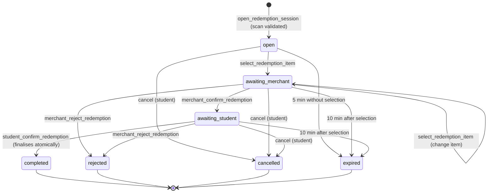

# Perqly QR redemption specification

**Phase 1: how a verified student redeems a discount by scanning a merchant's static QR code**

|         |                                                                                                                                                                     |
| ------- | ------------------------------------------------------------------------------------------------------------------------------------------------------------------- |
| Status  | Draft for approval. Not implemented                                                                                                                                 |
| Date    | 2026-11-14                                                                                                                                                          |
| Storage | Tables `merchant_qr_codes`, `redemption_sessions`, `redemptions`, `student_savings`, `audit_logs` in the [database architecture](./PERQLY_DATABASE_ARCHITECTURE.md) |

## 1. Principles

1. **The QR code only identifies a branch.** It encodes a random, revocable token. It carries no merchant data, no student data and no discount authorisation.
2. **The server decides everything.** Eligibility, prices, discounts and limits are calculated in the database. The app sends IDs and idempotency keys, never prices.
3. **Two people confirm.** The merchant confirms from an authenticated merchant account, then the student confirms. Without both, nothing is recorded as redeemed.
4. **Finalisation is atomic.** One transaction writes the redemption and every total it affects, or nothing at all.
5. **A completed redemption is final.** It can't be replayed or reused. Only Perqly support can void it after a dispute, and the void is audited.
6. **Perqly never handles the money.** The student pays the merchant directly. A redemption proves a discount was given, not that a payment was made.

## 2. The merchant QR code

### 2.1 Format

| Element          | Value                                                                                                                                        |
| ---------------- | -------------------------------------------------------------------------------------------------------------------------------------------- |
| Encoded content  | `https://<perqly-domain>/r/<token>`. Until a domain is chosen: `https://perqly-eta.vercel.app/r/<token>`                                     |
| `token`          | 16 random bytes from `gen_random_bytes`, base64url without padding (22 characters, 128 bits)                                                 |
| `short_code`     | 8 Crockford base32 characters, printed under the QR, for typing in if the camera fails                                                       |
| Error correction | Level M, with at least a 4-module quiet zone                                                                                                 |
| Printed poster   | Merchant name, branch name, "Student? Scan with Perqly", the QR, the short code, and "Perqly never takes payment. Pay the merchant directly" |

Encoding a link rather than a bare token means a phone's own camera app opens Perqly too. The app is still in charge: the link only starts the server-side process.

### 2.2 Lifecycle

- A branch gets its first code when the merchant is approved and the branch has a location.
- Each branch has exactly **one active code** (database constraint).
- `reissue_branch_qr(branch_id, reason)` (owner or manager) revokes the active code and issues a new one with `version + 1`, in one transaction. Use it when a code is photographed and misused, damaged, or the branch moves.
- `revoke_qr_code(qr_code_id, reason)` (Perqly admin) revokes without reissuing, for example when a branch is suspended.
- A revoked code is rejected immediately. Sessions already open from it keep running until they end, because they were validated when opened.
- Every issue, reissue, revocation and download is written to `audit_logs`.

### 2.3 Ways in

| Entry          | How it works                                                                                                                                                                                                                                                                                                                   |
| -------------- | ------------------------------------------------------------------------------------------------------------------------------------------------------------------------------------------------------------------------------------------------------------------------------------------------------------------------------ |
| In-app scanner | `/student/scan` opens the rear camera. It decodes with the browser's `BarcodeDetector` where available, otherwise a small JavaScript or WebAssembly QR decoder (iPhone Safari has no `BarcodeDetector`). Only links matching `/r/<22 chars>` on the Perqly domain are accepted; anything else shows "That's not a Perqly code" |
| Phone camera   | Opens `/r/<token>`. If the student isn't signed in, they sign in and return to the same link. If Perqly is installed, the link may open in the browser rather than the installed app, which works the same                                                                                                                     |
| Short code     | "Can't scan? Enter the code" on `/student/scan`. Limited to 5 attempts per 10 minutes per student                                                                                                                                                                                                                              |

`/r/<token>` is a server route that never caches (`Cache-Control: no-store`) and must be added to the service worker's NetworkOnly list (conflict C9 in the product specification). It calls `open_redemption_session()` and redirects to `/student/redeem/<session_id>`. The token never appears in analytics or logs; only the QR code's ID is logged.

## 3. Redemption session state machine

| From                                    | To                  | Trigger                                                                                  | Who                                                |
| --------------------------------------- | ------------------- | ---------------------------------------------------------------------------------------- | -------------------------------------------------- |
| —                                       | `open`              | `open_redemption_session`                                                                | Verified student                                   |
| `open`                                  | `awaiting_merchant` | `select_redemption_item`                                                                 | The session's student                              |
| `awaiting_merchant`                     | `awaiting_merchant` | `select_redemption_item` with a different item (resets the price snapshot and pass code) | The session's student                              |
| `awaiting_merchant`                     | `awaiting_student`  | `merchant_confirm_redemption`                                                            | Owner, manager or a cashier assigned to the branch |
| `awaiting_student`                      | `completed`         | `student_confirm_redemption`, which calls `private.finalize_redemption`                  | The session's student                              |
| `awaiting_merchant`, `awaiting_student` | `rejected`          | `merchant_reject_redemption` with a reason                                               | Merchant user of the branch                        |
| any live state                          | `cancelled`         | `cancel_redemption_session`                                                              | The session's student                              |
| any live state                          | `expired`           | `expires_at` passed (checked in every function, and by the per-minute job)               | System                                             |

Live states are `open`, `awaiting_merchant` and `awaiting_student`. `completed`, `rejected`, `cancelled` and `expired` are final and never change again.

The confirmation order follows the brief: merchant first, then student (decision D7). The student's confirm button stays disabled with "Waiting for the merchant to confirm" until the merchant has confirmed.

## 4. Step by step

Each step names the database function the app calls (through a Next.js Server Action), what it checks and what it returns. Every function runs as `security definer`, uses `auth.uid()` for identity and ignores any identity the client claims.

### Step 1: the student visits the merchant

They receive the service or buy the product. For a booked service, the booking should be `confirmed`.

### Step 2: the student scans

The app extracts the token (or short code) and calls:

`open_redemption_session(p_token text, p_short_code text, p_client_request_id uuid, p_distance_hint jsonb)`

`p_distance_hint` is optional `{lat, lng, accuracy_m}` if the student allowed location. It's used only to compute `distance_m` and `location_signal`; coordinates are never stored.

### Step 3: validate the student and the merchant

All checks run in one transaction. The first failure stops the call with a named error (section 9).

| #   | Check                                                                                                                                                                             | Error                                                                         |
| --- | --------------------------------------------------------------------------------------------------------------------------------------------------------------------------------- | ----------------------------------------------------------------------------- |
| 1   | Caller is signed in and their profile isn't suspended                                                                                                                             | `not_authenticated`, `account_suspended`                                      |
| 2   | Rate limits: scans (6/minute), sessions (10/hour), short-code attempts (5/10 minutes)                                                                                             | `rate_limited`                                                                |
| 3   | `student_profiles.verification_status = 'verified'` and `verified_until > now()`                                                                                                  | `not_verified`, `verification_expired`                                        |
| 4   | The student's institution is `pilot` or `active`                                                                                                                                  | `institution_inactive`                                                        |
| 5   | The token (or short code) matches a `merchant_qr_codes` row with `status = 'active'`                                                                                              | `qr_invalid` (same message for unknown and revoked, so codes can't be probed) |
| 6   | The code's branch is active and its merchant is `approved`                                                                                                                        | `merchant_unavailable`                                                        |
| 7   | At least one offer is redeemable at this branch for this student right now (section 6)                                                                                            | `no_eligible_offers`                                                          |
| 8   | The student has no other live session. A live session **at the same branch** is returned instead of creating a new one (resume). A live session elsewhere must be cancelled first | `session_in_progress` (with the other session's ID)                           |
| 9   | Idempotency: if `(student_id, client_request_id)` already exists, return that session unchanged                                                                                   | —                                                                             |

On success it creates the session (`open`, `expires_at = now() + 5 minutes`), updates `last_scanned_at` on the QR code, writes `redemption.session_opened` to the audit log, and returns:

- session ID, `public_ref`, `expires_at`;
- merchant display name, logo, branch name;
- eligible offers, each with item name, regular price, discount, final price (all from `private.price_offer`), conditions, and how many uses the student has left in the current period;
- the student's `confirmed` bookings at this branch for today, so they can link one.

### Step 4: the student picks what they bought

`select_redemption_item(p_session_id uuid, p_offer_id uuid, p_booking_id uuid)`

Checks: the session is the caller's and is `open` or `awaiting_merchant` without merchant confirmation; it hasn't expired; the offer is in the eligible set (re-checked, not trusted from step 3); the student's limits allow one more (section 7); the booking, if given, belongs to the student, is at this branch, is `confirmed` and is for the offer's service.

### Step 5: the server calculates the discount

`private.price_offer(offer_id)` returns the regular price, discount amount and final price (database architecture, section 5.6). The session stores a **snapshot**: item name, regular price, discount type and value, discount amount, final price. It then sets a fresh 4-digit `pass_code`, `selected_at = now()`, `status = 'awaiting_merchant'` and `expires_at = now() + 10 minutes`.

The snapshot is what both sides confirm and what is recorded. If the merchant changes the item's price a minute later, this session isn't affected.

### Step 6: the student reviews the transaction

`/student/redeem/<session_id>` shows the review screen and the live pass:

| Shown                          | Source                                                                                                                                               |
| ------------------------------ | ---------------------------------------------------------------------------------------------------------------------------------------------------- |
| Merchant name and branch       | Session                                                                                                                                              |
| Service or product             | Snapshot                                                                                                                                             |
| Original price                 | Snapshot `regular_price`                                                                                                                             |
| Student discount               | Snapshot, e.g. "20% off, −GH₵16.00"                                                                                                                  |
| **Amount to pay the merchant** | Snapshot `final_price`, in large type                                                                                                                |
| Live pass                      | Student's photo and first name, institution, 4-digit pass code, `public_ref`, a running clock with seconds, the colour of the day, and the time left |
| Status                         | "Waiting for the merchant to confirm"                                                                                                                |
| Note                           | "Pay the merchant directly. Perqly doesn't take payments."                                                                                           |

The running clock and colour of the day make a screenshot easy to spot: the clock stops, and on another day the colour is wrong. The pass code helps the cashier find the right row when several students are waiting.

### Step 7: the merchant confirms

The counter screen (`/merchant/counter`, Realtime) shows each `awaiting_merchant` session at their branches with: student first name and photo (short signed URL), institution, item, original price, discount, final price, pass code, `public_ref` and time left. The cashier compares the photo and code with the student's screen, then taps **Confirm discount**.

`merchant_confirm_redemption(p_session_id uuid, p_expected_final_price numeric, p_client_request_id uuid)`

Checks: `private.can_operate_branch(branch_id)`; status `awaiting_merchant`; not expired; the merchant is still approved; `p_expected_final_price` equals the snapshot (if the student changed the item after the cashier's screen loaded, it fails with `session_changed` and the list refreshes). Sets `merchant_confirmed_at`, `merchant_confirmed_by`, status `awaiting_student`, writes `redemption.merchant_confirmed`.

Idempotent: a repeat call by the same user on an already confirmed session returns success without changes. A second cashier confirming the same session at the same moment is serialised by `select … for update` and receives `already_confirmed`.

**Reject:** `merchant_reject_redemption(p_session_id, p_reason)` with a preset reason (`not_this_student`, `item_not_purchased`, `wrong_item`, `offer_not_honoured_today`, `other` + note). Status `rejected`, audited. The student sees the reason and can open a dispute.

### Step 8: the student confirms

The student's screen flips (Realtime) to "Merchant confirmed. Confirm you're paying GH₵64.00 for Haircut and beard trim." with a **Confirm** button.

`student_confirm_redemption(p_session_id uuid, p_client_request_id uuid)`

Checks: the caller owns the session; status `awaiting_student`; not expired. Then it calls `private.finalize_redemption(session_id)` **in the same transaction**.

### Step 9: complete the redemption atomically

`private.finalize_redemption(p_session_id uuid)` runs inside the caller's transaction:

1. `select … from redemption_sessions where id = p_session_id for update`. If the status isn't `awaiting_student` or it has expired, raise and roll back.
2. `select … from offers where id = session.offer_id for update` (serialises everyone redeeming this offer, so the total cap can't be overrun).
3. Re-check: student still verified and not suspended; merchant still approved; offer not `rejected` or `archived`; the offer was `active` when the item was selected; the student's per-period limit (counting completed redemptions); the offer's `total_cap`.
4. Insert into `redemptions` with the session's snapshot. `session_id` is unique, so a second insert for the same session fails even if every other check were bypassed.
5. Update `offers.redemption_count = redemption_count + 1`; if it reaches `total_cap`, set the offer to `expired`.
6. Upsert `student_savings`: add `discount_amount` to `total_saved` and `final_price` to `total_spent_at_student_price`, increment `redemption_count`, set first and last timestamps.
7. If `booking_id` is set: set the booking to `completed`, `completed_at = now()`, `redemption_id`.
8. Set the session to `completed`, `student_confirmed_at = now()`, `completed_at = now()`.
9. Write `redemption.completed` to the audit log (session, redemption, offer, amounts).
10. Insert in-app notifications: student ("You saved GH₵16.00 at Fresh Fade"), merchant ("Redemption PQ-7K3M9Q2D completed").

If any step fails, the whole transaction rolls back and the session stays `awaiting_student` (or becomes `expired` on the next check). The student sees a clear error and can retry the confirm; the retry is safe because of steps 1 and 4.

### After completion

- The student sees a receipt: merchant, branch, item, original price, discount, **amount to pay the merchant**, `public_ref`, time, and "Discount redeemed. Pay the merchant directly." It never says "Paid".
- The merchant can record how the student paid: `record_payment(p_redemption_id, p_method, p_status)` with `mtn_momo`, `telecel_cash`, `at_money`, `cash`, `card` or `other`, and `paid` or `unpaid`. Allowed for 7 days, for merchant users who can operate the branch. Shown everywhere as "Payment recorded by the merchant".
- A student who leaves without confirming leaves the session to expire as `expired` with `merchant_confirmed_at` set. Those sessions count toward the student's limits (section 7), are visible to the merchant as "Confirmed by you, not by the student", and raise an admin flag if they repeat.

## 5. Discount calculation

All amounts are GH₵, `numeric(12,2)`, rounded half away from zero. The calculation lives only in `private.price_offer`.

| Offer                              | Regular price | Discount                        | Final price                   |
| ---------------------------------- | ------------- | ------------------------------- | ----------------------------- |
| 20% off "Haircut and beard trim"   | 80.00         | 80.00 × 20% = 16.00             | 64.00                         |
| 15% off "Waakye with chicken"      | 35.00         | 35.00 × 15% = 5.25              | 29.75                         |
| 12.5% off "Phone screen protector" | 45.00         | 45.00 × 12.5% = 5.625 → 5.63    | 39.37                         |
| GH₵10 off "Dental check-up"        | 150.00        | 10.00                           | 140.00                        |
| GH₵10 off an item now priced GH₵8  | 8.00          | Invalid: fixed discount ≥ price | Offer unavailable until fixed |

The client renders these numbers; it never computes them for anything that's recorded.

## 6. Offer eligibility at a branch

An offer is redeemable by a student at a branch right now if all of these hold:

- offer `status = 'active'`, `starts_at <= now()`, and `ends_at` is null or in the future;
- `offer_branches` is empty or contains the branch;
- `institution_scope = 'all'`, or `offer_institutions` contains the student's institution;
- its service or product is active (and, for a service, linked to the branch in `service_branches`);
- for a fixed discount, the discount is below the item's current price;
- `total_cap` is null or not reached;
- the student has uses left in the current period.

## 7. Redemption limits

- **Per student:** `per_student_limit` uses per `per_student_period`. Periods follow the Africa/Accra calendar: `day` is the calendar day, `week` starts on Monday, `month` is the calendar month, and `offer_lifetime` is the whole offer.
- **What counts:** completed (not voided) redemptions, plus sessions that expired after the merchant confirmed (section 4, "After completion"). Rejected, cancelled and other expired sessions don't count.
- **Total cap:** completed redemptions only, checked under the offer row lock at finalisation.
- **Checked twice:** when the item is selected (so the student isn't sent to the counter for nothing) and at finalisation (the authoritative check).

## 8. Security controls

| Requirement                           | Mechanism                                                                                                                                                                                        |
| ------------------------------------- | ------------------------------------------------------------------------------------------------------------------------------------------------------------------------------------------------ |
| QR authenticity                       | 128-bit random token; server lookup against active `merchant_qr_codes`; unknown and revoked return the same error                                                                                |
| Merchant and branch verification      | Merchant `approved`, branch active, checked at scan, at merchant confirmation and at finalisation                                                                                                |
| No sensitive data in the QR           | The token is opaque; the link contains nothing else                                                                                                                                              |
| Static QR never authorises a discount | A scan only opens a session. A discount is recorded only after merchant confirmation, student confirmation and the finalisation checks                                                           |
| Short-lived sessions                  | 5 minutes to select, then 10 minutes to confirm (from `app_settings`), enforced in every function and by a per-minute expiry job                                                                 |
| Unique transaction identifiers        | `public_ref` (unique, 8 Crockford base32 characters after `PQ-`) and the session UUID; `redemptions.transaction_ref` unique                                                                      |
| Idempotency                           | `client_request_id` on session creation and confirmations; unique `(student_id, client_request_id)`; repeat confirmations are no-ops                                                             |
| Duplicate redemption prevention       | `redemptions.session_id` unique; one live session per student; session row lock; final states are terminal                                                                                       |
| Expiration of pending transactions    | `expires_at` checks plus the `expire_redemption_sessions` job                                                                                                                                    |
| Merchant confirmation authorisation   | `private.can_operate_branch()`: owner or manager, or a cashier assigned to that branch; suspended accounts fail; owners use two-factor sign-in                                                   |
| Student confirmation                  | Only the session's student, only after the merchant confirms                                                                                                                                     |
| Server-side pricing                   | `private.price_offer`; snapshot stored on the session; the merchant's confirm call includes the expected final price to catch changes                                                            |
| Rate limiting                         | Section 10, in `private.check_rate_limit()`                                                                                                                                                      |
| Audit logging                         | Section 11                                                                                                                                                                                       |
| Remote misuse of a photographed QR    | Merchant confirmation is required, so a remote scan can't complete. The location signal and repeated "confirmed but not completed" sessions raise admin flags; the merchant can reissue the code |
| Account sharing                       | The pass shows the student's photo; the cashier compares it before confirming                                                                                                                    |
| Data minimisation                     | Merchants see first name, photo and institution only during the session; distance is stored, never coordinates                                                                                   |

## 9. Errors and messages

| Error                          | Message to the student                                                                           |
| ------------------------------ | ------------------------------------------------------------------------------------------------ |
| `not_verified`                 | "Your school needs to verify you before you can redeem discounts." (link to verification status) |
| `verification_expired`         | "Your verification has expired. Verify again to keep redeeming."                                 |
| `account_suspended`            | "Your account is suspended. Contact Perqly support."                                             |
| `qr_invalid`                   | "This code isn't active. Ask the shop for their current Perqly code."                            |
| `merchant_unavailable`         | "This business isn't taking Perqly discounts right now."                                         |
| `no_eligible_offers`           | "There are no student discounts you can use here right now."                                     |
| `session_in_progress`          | "You have another redemption open at {merchant}. Finish or cancel it first."                     |
| `limit_reached`                | "You've used this discount {n} times this {period}. It resets on {date}."                        |
| `offer_unavailable`            | "This discount isn't available any more."                                                        |
| `session_expired`              | "This redemption timed out. Scan the code again to start over."                                  |
| `session_changed` (merchant)   | "The student changed their item. Check the updated details."                                     |
| `already_confirmed` (merchant) | "Another staff member already confirmed this one."                                               |
| `rejected`                     | "{merchant} declined this redemption: {reason}." (with "Report a problem")                       |
| `rate_limited`                 | "Too many attempts. Wait a minute and try again."                                                |
| `network` (client)             | "No connection. Redeeming needs internet; your progress is saved."                               |

## 10. Rate limits

| Action                     | Limit                              | Subject       |
| -------------------------- | ---------------------------------- | ------------- |
| Scan / open session        | 6 per minute, 10 sessions per hour | Student       |
| Short-code entry           | 5 per 10 minutes                   | Student       |
| Select item                | 20 per session                     | Student       |
| Merchant confirm or reject | 60 per minute                      | Merchant user |
| Reissue QR                 | 5 per day                          | Branch        |
| Record payment             | 120 per hour                       | Merchant user |

Limits are stored in `app_settings` so they can be tuned without a deploy. Breaches are audited when they repeat.

## 11. Audit events

`redemption.session_opened`, `redemption.item_selected`, `redemption.merchant_confirmed`, `redemption.merchant_rejected`, `redemption.cancelled`, `redemption.expired` (only those with merchant confirmation, to keep the log small), `redemption.completed`, `redemption.payment_recorded`, `redemption.voided`, `qr.issued`, `qr.reissued`, `qr.revoked`, `qr.downloaded`, `qr.invalid_scan` (sampled, with the QR ID if known, never the token).

## 12. Realtime and offline behaviour

- The student's redeem screen and the merchant's pending list subscribe to `redemption_sessions` changes through Supabase Realtime (Postgres Changes), which applies RLS. A 5-second polling fallback covers dropped sockets.
- Redemption always needs a connection. The redeem routes are NetworkOnly in the service worker and are never cached. Offline, the app shows the offline page and keeps the session ID so the student can resume.
- Reopening `/student/redeem/<session_id>` resumes a live session; ended sessions show their final state.

## 13. Edge cases

| Case                                                                    | Behaviour                                                                                                                                                        |
| ----------------------------------------------------------------------- | ---------------------------------------------------------------------------------------------------------------------------------------------------------------- |
| Student's phone loses signal mid-flow                                   | Session continues on the server; the student resumes from the same URL before it expires                                                                         |
| Two cashiers confirm at once                                            | Row lock: one succeeds, the other gets `already_confirmed`                                                                                                       |
| Student changes item after the cashier's screen loaded                  | Merchant confirm fails with `session_changed`; list refreshes                                                                                                    |
| Merchant changes the price during a session                             | The session's snapshot is honoured                                                                                                                               |
| Offer paused or ended after the item was selected                       | Honoured if the session completes before it expires; the cap and limits are still enforced                                                                       |
| Offer rejected or archived by moderation during a session               | Finalisation fails with `offer_unavailable`                                                                                                                      |
| Student's verification expires or account is suspended during a session | Finalisation fails                                                                                                                                               |
| Merchant suspended during a session                                     | Merchant confirmation and finalisation fail                                                                                                                      |
| QR revoked during a session                                             | The open session continues; new scans fail                                                                                                                       |
| Student leaves after the merchant confirms                              | Session expires; counts toward limits; merchant sees it; repeated cases are flagged                                                                              |
| Merchant never confirms                                                 | Session expires; nothing recorded; the student can scan again                                                                                                    |
| Student scans a second shop while a session is open                     | `session_in_progress`; the student cancels the first                                                                                                             |
| Dispute after completion                                                | Student or merchant opens a dispute; support investigates and can void with a reason; voiding subtracts from `student_savings` and decrements `redemption_count` |

## 14. Payment separation

- No table stores card numbers, MoMo numbers or payment references.
- `payment_method` and `payment_status` on `redemptions` are the merchant's own note, optional, and labelled "Recorded by the merchant".
- Receipts and history say "Discount redeemed" and "Amount to pay the merchant", never "Paid via Perqly".
- No payment gateway, webhook or wallet is part of Phase 1.

## 15. Acceptance tests

Database tests (pgTAP) and end-to-end tests (two browsers, one student and one merchant) must cover at least:

1. Happy path: scan → select → merchant confirm → student confirm → one `redemptions` row with the snapshot; `student_savings`, `offers.redemption_count` and the linked booking updated; the session is `completed`.
2. Unverified, expired-verification and suspended students can't open a session.
3. Unknown, revoked and malformed tokens all return `qr_invalid`.
4. A suspended merchant or inactive branch returns `merchant_unavailable`.
5. A student can't select an offer from another branch, another merchant, another institution's scope, or an inactive offer.
6. Sending a price from the client has no effect (the functions have no price parameter apart from the merchant's expected-price guard).
7. The student can't confirm before the merchant; a cashier from another branch can't confirm; a student can't call the merchant functions.
8. Calling `student_confirm_redemption` twice, in parallel, creates exactly one redemption.
9. Two students finalising the last unit of a capped offer at the same time: one succeeds, one gets `offer_unavailable`.
10. Limits: the (n+1)th redemption within the period fails; it succeeds after the period resets.
11. Expiry: a session past `expires_at` can't be confirmed, even before the job runs.
12. Completed, rejected, cancelled and expired sessions can't change state.
13. `redemptions` can't be updated (except payment fields by the branch's merchant users, and void fields by support) or deleted by anyone.
14. Every state change writes the expected audit event; no audit row contains a token or a photo.
15. Rate limits trigger at the configured thresholds.
16. Voiding a redemption restores the student's savings and the offer count, and is audited.
